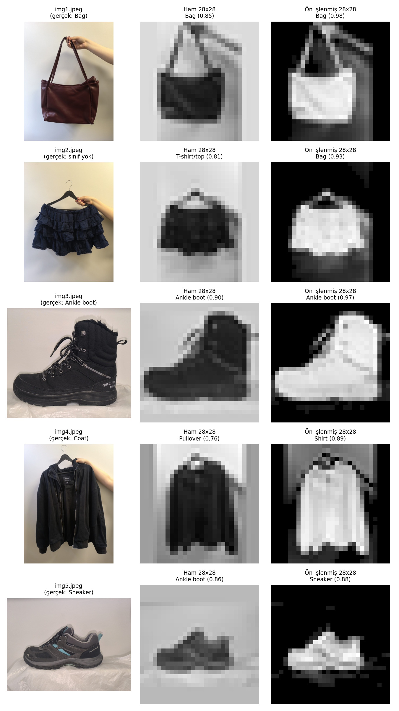

# Fashion-MNIST ResNet18 Sınıflandırma

Fashion-MNIST veri seti üzerinde ResNet18 modeli ile giysi görüntülerinin sınıflandırılması.

## Proje Hakkında

Bu projede ResNet18 mimarisi 10 farklı giysi sınıfına sahip FASHION-MNIST veri seti kullanılarak eğitilmiş, eğitilen model telefonum ile çektiğim görüntüler üzerinde denenmiştir. Gradio ile çalışan bir web uygulamasına dönüştürülmüştür.

## Sonuçlar

| Ölçüt                                                | Değer                    |
| ---------------------------------------------------- | ------------------------ |
| Test doğruluğu (10.000 görüntü)                      | %95,11                   |
| Macro Precision / Recall / F1                        | 0,9511 / 0,9511 / 0,9511 |
| En iyi doğrulama doğruluğu                           | %95,02                   |
| Eğitim süresi (10 epoch, RTX 4060 Laptop GPU)        | 138,2 s                  |
| Tahmin süresi (batch = 1, GPU, yalnızca ileri geçiş) | 0,853 ms                 |

En zayıf sınıflar Shirt (F1 = 0,8574), T-shirt/top (0,9035), Pullover (0,9283) ve Coat (0,9298); hepsi birbirine benzeyen üst gövde giysileridir. Sınıf bazlı tüm değerler `outputs/classification_report.txt` dosyasındadır.



## Klasör Yapısı

```
.
├── app.py                # Gradio uygulaması
├── train.py              # Eğitim, değerlendirme, metrik ve grafik üretimi
├── predict_photos.py     # Kendi fotoğrafları üzerinde tahmin (ham / ön işlemli)
├── requirements.txt
├── README.md
├── outputs/              # best_resnet18.pt, metrics.json, classification_report.txt,
│                         # confusion_matrix.png, training_curves.png,
│                         # photo_results.csv, photo_results.png
├── photos/               # kendi fotoğraflarım
└── Dataset/              # Fashion-MNIST CSV dosyaları (Kaggle'dan indirilmeli)
```

## Kurulum

```bash
git clone https://github.com/zehracerenkocaman/fashion-mnist-resnet18-classification.git
cd fashion-mnist-resnet18-classification
python3 -m venv venv
source venv/bin/activate
pip install -r requirements.txt
```
Veri seti URL: https://www.kaggle.com/datasets/zalando-research/fashionmnist.

İndirilen dosyanın içerisindeki fashion-mnist_train.csv, fashion-mnist_test.csv dosyaları Dataset/ klasörüne yüklenmelidir.

## Kullanım

Eğitim:
```bash
python train.py --data_dir /yol/fashionmnist --epochs 10
```

Fotoğraflar üzerinde tahmin:
```bash
python3 predict_photos.py --images photos --weights outputs/best_resnet18.pt
```

Uygulamayı çalıştırma:
```bash
python app.py
```
